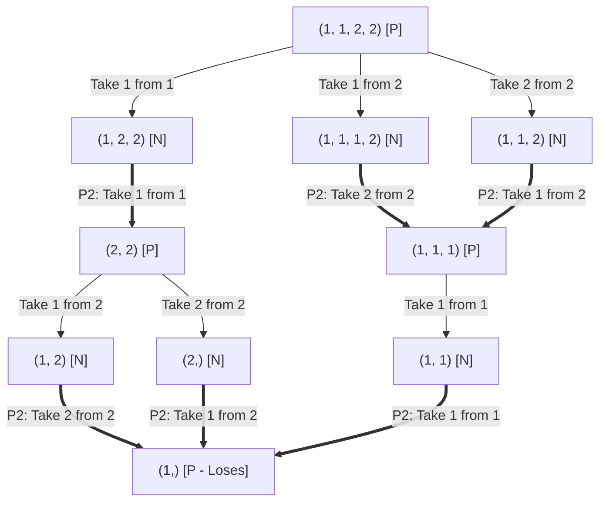

# Problem Set 01 — Thought Process, Catches & Solutions

**Module:** Spieltheorie (WS 26/27) — Goethe University Frankfurt  
**Solvers:** [`misere_nim_solver.py`](misere_nim_solver.py) | [`chomp_solver.py`](chomp_solver.py)

---

## How I Approached Coding Both Games: The 3-Function Pattern

While working through Problem 1 and Problem 2, I realized both games follow the exact same structure in code. Instead of writing custom player-tracking loops, any finite impartial game like Nim or Chomp really comes down to **three core functions**:

1. **Maintaining & Generating States (`get_transitions` + canonical state format):**  
   Keeps the game state in an immutable, clean format (a sorted `tuple[int, ...]` for Nim piles, or a 2D `tuple[tuple[int, ...], ...]` for Chomp) and generates all valid states reachable in one legal move.
2. **Evaluating States (`is_winning_state`):**  
   Starts from the terminal base case and works backwards recursively with `@lru_cache(maxsize=None)`. Because the rules are identical for both players, I don't even need a `current_player` variable: a state evaluates to `True` ($\mathcal{N}$-position) if **at least one** move leads to a `False` ($\mathcal{P}$-position) for the next player; otherwise it returns `False`.
3. **Playing Optimal Moves (`get_optimal_move` / `find_optimal_move`):**  
   Once `is_winning_state` knows which states are traps, this function loops over the legal transitions from the current board and picks the actual move that forces the opponent into a `False` state (`not is_winning_state(next_state)`).

---

## Problem 1: Four Piles of Matches `(1, 1, 2, 2)`

### 1. Testing Small Cases by Hand First
Before brute-forcing `(1, 1, 2, 2)` in Python, I tested tiny endgames on paper starting from the end of the game (remembering that taking up to 2 matches is allowed, and **taking the last match loses**):
- **`(1,)` is the ultimate trap ($\mathcal{P}$):** Only 1 match left—whoever has to move here is forced to take it and loses.
- **`(2,)`, `(1, 1)`, and `(1, 2)` are all winning ($\mathcal{N}$):** From any of these, I can remove 1 or 2 matches to leave `(1,)` for my opponent.
- **`(2, 2)` and `(1, 1, 1)` are traps ($\mathcal{P}$):**
  - From `(2, 2)`, taking 1 leaves `(1, 2)` and taking 2 leaves `(2,)`—both let the other player immediately drop me into `(1,)`.
  - From `(1, 1, 1)`, the only move is taking 1, leaving `(1, 1)`, which again lets the other player leave `(1,)`.
- **Stepping back to `(1, 1, 2, 2)`:** Once I saw `(2, 2)` and `(1, 1, 1)` were losing traps, I checked all 3 possible opening moves from `(1, 1, 2, 2)` by hand and noticed that **every single one** lets Player 2 jump straight into either `(2, 2)` or `(1, 1, 1)`!

Then I wrote [`misere_nim_solver.py`](misere_nim_solver.py) to verify the entire graph and make sure I didn't miss an alternative branch.

### 2. Catches and Gotchas Along the Way
- **Catch 1 — The Misère base-case flip:** In regular Nim (where taking the last match wins), an empty board `()` means you have no moves left and lose (`False`). Here, if the recursion reaches `()`, it means the *previous* player just took the last match and lost—so `is_winning_state(())` has to return `True`! Getting that single boolean backwards flips every result in the tree.
- **Catch 2 — Merging equivalent pile orders:** Drawing the raw extensive-form game tree explodes because `(1, 2, 1, 2)`, `(2, 1, 1, 2)`, and `(0, 1, 2, 2)` look different even though they are the exact same game. Dropping `0`s and sorting the tuple (`tuple(sorted(new_state))`) shrinks the whole game down to just **12 unique states**.
- **Catch 3 — Capping subtraction on size-1 piles:** Since the rule allows taking *1 or 2* matches, I had to be careful on piles of size `1` not to subtract `2` (`range(1, min(2, pile_size) + 1)`), otherwise you generate fake "take 2 from 1" labels.

### 3. Game Graph & Player 2's Winning Strategy
Since `(1, 1, 2, 2)` evaluates to `False` ($\mathcal{P}$-position), **Player 2 has a guaranteed winning strategy** by always pushing the game into `(2, 2)`, `(1, 1, 1)`, and finally `(1,)`:



| Stage | Player 1 Move | State Left | Player 2 Winning Reply | Trap State Reached |
| :--- | :--- | :--- | :--- | :--- |
| **Opening** `(1, 1, 2, 2)` | Take 1 from a `1`-pile | `(1, 2, 2)` | **Take 1 from remaining `1`-pile** | **`(2, 2)`** |
| **Opening** `(1, 1, 2, 2)` | Take 1 from a `2`-pile | `(1, 1, 1, 2)` | **Take 2 from remaining `2`-pile** | **`(1, 1, 1)`** |
| **Opening** `(1, 1, 2, 2)` | Take 2 from a `2`-pile | `(1, 1, 2)` | **Take 1 from remaining `2`-pile** | **`(1, 1, 1)`** |
| **Midgame** `(2, 2)` | Take 1 from `2` $\to$ `(1, 2)` | `(1, 2)` | **Take 2 from remaining `2`-pile** | **`(1,)`** |
| **Midgame** `(2, 2)` | Take 2 from `2` $\to$ `(2,)` | `(2,)` | **Take 1 from remaining `2`-pile** | **`(1,)`** |
| **Midgame** `(1, 1, 1)` | Take 1 from `1` $\to$ `(1, 1)` | `(1, 1)` | **Take 1 from a `1`-pile** | **`(1,)`** |

---

## Problem 2: Game of Chomp

### 1. Spotting the $2 \times 4$ Pattern by Hand Before Coding
Before running [`chomp_solver.py`](chomp_solver.py), I sketched smaller 2-row chocolate bars (`2x1`, `2x2`, `2x3`) following Figure 1 on the problem sheet (poison `X` at the bottom-right `(1, 3)`, and eating `(r, c)` removes everything **above and to the left**):
- On `2x1`, eating the top piece `(0, 0)` immediately leaves just the poison `X` at `(1, 0)`.
- On `2x2`, eating `(0, 0)` leaves **1 piece in the top row** and **2 pieces in the bottom row**. Whichever safe piece Player 2 eats next, I can eat the other safe piece and leave only `X`.
- Testing `2x3` and `2x4` showed the exact same pairing rule! Every losing trap ($\mathcal{P}$-position) on a $2 \times n$ board has **1 fewer piece in the top (safe) row than in the bottom (poisoned) row**:
  $$(a, b) \in \{(3, 4),\, (2, 3),\, (1, 2),\, (0, 1)\}$$

So on the **$2 \times 4$ grid**, **Player 1 has a winning strategy**:
- **Opening Move:** Eat the single top-left piece `(0, 0)`, leaving `(3, 4)`:
  ```text
  (0, 1, 1, 1)   <-- 3 pieces left
  (1, 1, 1, X)   <-- 4 pieces left (poison X at bottom-right)
  ```
- **How Player 1 responds from any `(k - 1, k)` trap:**
  1. If Player 2 eats from the **top row** down to `k'` pieces (`(k', k)`), I bite the **bottom row** down to `k' + 1` pieces (`(k', k' + 1)`).
  2. If Player 2 eats from the **bottom row** down to `k'` pieces (which automatically wipes out the pieces above it too, leaving `(k', k')`), I bite the leftmost remaining piece in the **top row** to restore `(k' - 1, k')`.
  Either way, `k` shrinks every round until Player 2 is stuck with `(0, 1)` (only `X` left) and loses.

### 2. Catches & Gotchas While Coding Chomp
- **Catch 1 — Poison coordinates match Figure 1 (bottom-right):** A lot of standard Chomp examples online put the poison at the top-left `(0, 0)` and bite down/right. On our sheet (Figure 1), the poison is at **bottom-right** `(rows - 1, cols - 1)` and bites clear **above and left** (`0 <= i <= r`, `0 <= j <= c`). Mixing those up reverses the coordinates.
- **Catch 2 — Not letting the solver "choose" the poison:** When generating moves, I had to explicitly ignore `(rows - 1, cols - 1)` (or skip states where `next_state[-1][-1] == 0`) and set `pieces_left == 1` to `False`, so the solver knows being left with 1 piece is an automatic loss.
- **Catch 3 — Mutating grids vs. `@lru_cache`:** Python `list`s aren't hashable, so inside `get_transitions` I copy the board to `list[list[int]]` to zero out the eaten rectangle, then convert it right back to `tuple[tuple[int, ...], ...]`. Also, `@lru_cache(maxsize=None)` needs to sit on `is_winning_state` too—not just `get_transitions`—otherwise the recursive game tree still re-evaluates identical boards over and over!

---

### 3. Why Player 2 Can Never Have a Winning Strategy ($m \times n \neq 1 \times 1$)

Trying to find a neat formula like `(k - 1, k)` for general $m \times n$ boards gets complicated quickly, which is why the problem sheet hints at **proof by contradiction** (the classic *Strategy-Stealing* argument):

1. **One player must have a winning strategy:** Chomp is finite, deterministic, has perfect information, and cannot end in a draw. By Zermelo's Theorem, the starting $m \times n$ grid $G_0$ is either winning for Player 1 ($\mathcal{N}$) or winning for Player 2 ($\mathcal{P}$).
2. **Assume Player 2 has a winning strategy:** Suppose $G_0$ is a $\mathcal{P}$-position for some $(m, n) \neq (1, 1)$. That means *every* opening move by Player 1 has a winning counter-move for Player 2.
3. **Test the tiny corner bite `(0, 0)`:** Since the bar has more than 1 piece, Player 1 can nibble just the top-left corner piece $(0, 0)$, which removes **only that single square**, leaving board $G_1$.
4. **Look at Player 2's winning reply:** By our assumption, Player 2 has a winning response on $G_1$—say, biting some piece $p = (r, c)$—which leaves a losing trap board $G_2 \in \mathcal{P}$.
5. **The contradiction (Strategy Stealing):** Biting $(r, c)$ clears the entire upper-left rectangle $0 \le i \le r,\, 0 \le j \le c$, which **already includes `(0, 0)` anyway**! That means biting `(0, 0)` and then biting $(r, c)$ produces the **exact same board $G_2$** as just biting $(r, c)$ on Move 1.
6. So Player 1 could have simply eaten $(r, c)$ on the very first turn, handing $G_2 \in \mathcal{P}$ straight to Player 2! That contradicts $G_0$ being a winning game for Player 2. Therefore, Player 1 always has a winning strategy whenever $(m, n) \neq (1, 1)$. $\blacksquare$
