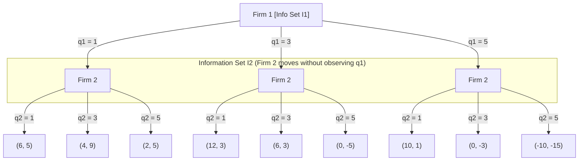

# Problem Set 02 — Thought Process, Catches & Solutions

**Module:** Spieltheorie (WS 26/27) — Goethe University Frankfurt  
**Solvers:** [`p1_cournot_duopoly.py`](p1_cournot_duopoly.py) | [`p2_beliefs_best_responses.py`](p2_beliefs_best_responses.py) | [`p3_dominance_nash.py`](p3_dominance_nash.py) | [`p4_student_initiative.py`](p4_student_initiative.py)

---

## Overview

Problem Set 2 moves away from sequential impartial games (like Nim and Chomp in PS1) and focuses on **static / simultaneous-move games** across four exercises: discrete Cournot competition, beliefs and best responses, iterated elimination of dominated strategies (IEDS / IEWDS), and pure Nash equilibria.

---

## Problem 1: Two Firms Compete in Quantities (Discrete Cournot Duopoly)

### 1. Initial Intuition & Why Derivatives Don't Work Here
In this problem, two smart-glasses firms choose their production quantities **simultaneously** from three discrete options—Small, Medium, or Large:

$$
q_i \in \lbrace 1, 3, 5 \rbrace, \quad p = 10 - q_1 - q_2, \quad \pi_i = (p - c_i)q_i \quad \text{with } c_1 = 2, \quad c_2 = 3
$$

My first economics instinct when seeing a Cournot profit function like $\pi_i = (10 - q_1 - q_2 - c_i)q_i$ was to take derivatives ($\frac{\partial \pi_i}{\partial q_i} = 0$) to solve for continuous reaction functions. **Catch #1:** Calculus only works when firms can pick *any* continuous real quantity $q_i \ge 0$. Because both firms are restricted to just three discrete jumps `{1, 3, 5}`, a continuous optimum might not even be a legal action! Instead, I had to evaluate all $3 \times 3 = 9$ discrete combinations directly and eliminate strictly dominated strategies round by round.

---

### 2. How I Structured the Python Solution ([`p1_cournot_duopoly.py`](p1_cournot_duopoly.py))

To translate my paper solution into clean Python without hardcoding numbers, I split the script into three building blocks:

#### A. Combinations & Strategic-Form Matrix (`compute_payoffs` & `build_strategic_form`)
- **`compute_payoffs(q1, q2)`:** Takes a pair of quantities, computes market price `price = 10 - q1 - q2`, and returns the profit tuple `(pi_1, pi_2)`.
- **`build_strategic_form(actions_1, actions_2)`:** Instead of computing and typing out all 9 cells manually, this runs nested loops over `ACTIONS = (1, 3, 5)` and maps each action pair `(q1, q2)` to `(pi_1, pi_2)` inside a Python dictionary. Using a `dict` keyed by `(q1, q2)` makes looking up any cell instantaneous (`matrix[(q1, q2)]`) without worrying about translating quantity `3` or `5` into list index `1` or `2`.

#### B. Dynamic Conditional Loop for IEDS (`run_ieds`)
- **Catch #2 — Never delete rows/columns from a matrix in-place:** If you store a payoff table as a 2D list and start popping rows or columns mid-loop, every remaining index shifts and breaks the comparisons.
- **How `run_ieds` avoids this:** I leave `matrix` completely untouched and maintain two active lists of surviving strategies: `active_q1 = [1, 3, 5]` and `active_q2 = [1, 3, 5]`.
- Inside a `while True:` loop, I use Python's `all(...)` to check whether another surviving strategy `alt_s` gives a **strictly higher (`>`)** profit than `s` against *every* currently surviving strategy of the other firm ($R^1 \subset S, \quad R^2 \subset R^1, \quad \dots$). Whenever a dominated action is removed, `changed = True` triggers another pass for the other firm; once a full round finishes with zero removals, the loop stops ($R^k = R^{k-1}$).

#### C. Nodes & Information Sets for the Extensive Form (`class Node` & `build_extensive_form`)
- **Catch #3 — Drawing a simultaneous game as a tree:** Extensive-form trees branch one player after another, even when players move at the same time. If I just built a normal tree with Firm 1 at the root and Firm 2 below it, it would look like Firm 2 gets to *see* Firm 1's quantity before choosing!
- **`class Node`:** Lightweight tree node storing `player`, `info_set`, `payoffs` (for leaf nodes, checked via `is_terminal()`), and a `children` dictionary mapping each chosen quantity to the next `Node`.
- **`build_extensive_form(actions_1, actions_2)`:** Places Firm 1 at the root (`info_set="I1"`) and creates three Firm 2 decision nodes—one per branch—that **all share the exact same `info_set="I2"`**. That shared ID is the code equivalent of drawing a dashed information set across Firm 2's nodes to show Firm 2 cannot tell which branch Firm 1 took.

---

### 3. Part (a): Extensive Form & Strategic Form

#### Extensive-Form Game Tree (with Information Set $I_2$)



#### Strategic-Form Payoff Matrix $(\pi_1, \pi_2)$

| Firm 1 \ Firm 2 | $q_2 = 1$ | $q_2 = 3$ | $q_2 = 5$ |
| :--- | :---: | :---: | :---: |
| **$q_1 = 1$** | `(6, 5)` | `(4, 9)` | `(2, 5)` |
| **$q_1 = 3$** | `(12, 3)` | `(6, 3)` | `(0, -5)` |
| **$q_1 = 5$** | `(10, 1)` | `(0, -3)` | `(-10, -15)` |

---

### 4. Part (b): Iterated Elimination of Strictly Dominated Strategies (IEDS)

Running `python -m problem_set_02.p1_cournot_duopoly` confirms the exact hand-worked elimination rounds:

1. **Round 1 — Eliminate `q1 = 5` and `q2 = 5`:**
   - **Firm 1:** Comparing `q1 = 3` against `q1 = 5` gives `12 > 10`, `6 > 0`, and `0 > -10`. So **`q1 = 5` is strictly dominated by `q1 = 3`**. (Note: `q1 = 1` cannot be eliminated yet because when `q2 = 5`, $\pi_1(1, 5) = 2 > \pi_1(3, 5) = 0$.)
   - **Firm 2:** Comparing `q2 = 3` against `q2 = 5` gives `9 > 5`, `3 > -5`, and `-3 > -15`. So **`q2 = 5` is strictly dominated by `q2 = 3`**.
2. **Round 2 — Eliminate `q1 = 1`:**
   - Once `q2 = 5` is gone, Firm 2 only has `{1, 3}` left. Across those two columns, `q1 = 3` beats `q1 = 1` everywhere (`12 > 6` and `6 > 4`). Now **`q1 = 1` is strictly dominated by `q1 = 3`**.
3. **Round 3 — Convergence & Catch #4 (Why both `q2 = 1` and `q2 = 3` survive!):**
   - With Firm 1 down to only `q1 = 3`, let's check Firm 2's remaining choices:
     - $\pi_2(3, 1) = (10 - 3 - 1 - 3) \cdot 1 = 3$
     - $\pi_2(3, 3) = (10 - 3 - 3 - 3) \cdot 3 = 3$
   - **Catch #4:** Both `q2 = 1` and `q2 = 3` give Firm 2 the **exact same profit of `3`**! If we were doing *weak* dominance earlier on `{1, 3} x {1, 3}`, `q2 = 3` giving `(9, 3)` vs. `q2 = 1` giving `(5, 3)` would have knocked out `q2 = 1`. But **IEDS requires strict inequality (`>`)**, so because `3 = 3`, neither `q2 = 1` nor `q2 = 3` strictly dominates the other (not even via a mix).

**Surviving Strategies under IEDS:**
- **Firm 1:** $q_1 \in \lbrace 3 \rbrace$ (i.e., `[3]`)
- **Firm 2:** $q_2 \in \lbrace 1, 3 \rbrace$ (i.e., `[1, 3]`)

> **Surviving strategy profiles:** `(3, 1)` with payoffs `(12, 3)`, and `(3, 3)` with payoffs `(6, 3)`.

---

## Problem 2: Beliefs and Best Responses

### 1. Initial Intuition & Moving from Pure Actions to Probability Weights
In Problem 2, we move from pure certainty into **beliefs ($\theta$)** and **mixed strategies ($\sigma$)** on a $3 \times 3$ static game where Player 1 chooses a row $s_1 \in \lbrace U, M, D \rbrace$ and Player 2 chooses a column $s_2 \in \lbrace L, C, R \rbrace$.

Because players are no longer picking a single pure move with 100% certainty, my main idea was to treat beliefs and mixed strategies as **probability weights** attached to each cell's payoff:
- When only the opponent's behavior is uncertain (a belief $\theta_{-i}$), I weight each of my pure actions across the opponent's probability distribution to see which action(s) maximize my expected payoff.
- When *both* players randomize independently ($\sigma_1$ and $\sigma_2$), the weight on any cell $(s_1, s_2)$ is the product of the two probabilities: $\sigma_1(s_1) \cdot \sigma_2(s_2)$.
- **Key Takeaway Looking Ahead to Problem 3:** Working through this made it clear why a strictly dominated strategy can *never* be a best response to any belief—and why an optimal mixed strategy will never put a positive probability weight on a strictly dominated pure strategy. That means we can always eliminate strictly dominated strategies first before solving for mixed strategies!

---

### 2. How I Structured the Python Solution ([`p2_beliefs_best_responses.py`](p2_beliefs_best_responses.py))

Just like in Problem 1, I stored the $3 \times 3$ table in a dictionary `MATRIX` mapping `(s1, s2) -> (u1, u2)` and built **three core functions** around it:

#### A. Pure Strategy Payoff Lookup (`get_pure_payoff`)
- **`get_pure_payoff(matrix, s1, s2, player)`:** Looks up the tuple `matrix[(s1, s2)]` and returns `matrix[(s1, s2)][player - 1]`.
- **Catch #1 — 1-based Player IDs vs. 0-based Tuple Indexing:** Game theory notation writes $u_1$ and $u_2$ (`player=1` or `player=2`), while Python tuples are indexed `[0]` and `[1]`. Subtracting `1` (`player - 1`) keeps the function calls readable (`player=1`, `player=2`) while grabbing the right tuple slot.

#### B. Weighting Payoffs by Beliefs & Finding Best Responses (`find_best_response`)
- **`find_best_response(matrix, own_actions, belief, player)`:** Loops over each of the player's pure actions, multiplies the cell payoff by the probability weight `prob` in `belief`, and stores the weighted sum in `expected_payoffs[action]`.
- **Catch #2 — Keeping `(row, col)` order straight for both players:** Because `MATRIX` is always keyed as `(row_action, col_action)`, the function flips the lookup key depending on whose best response we are finding:
  ```python
  cell = (action, opp_action) if player == 1 else (opp_action, action)
  ```
  That single line lets the exact same function compute $BR_1(\theta_2)$ for Player 1 and $BR_2(\theta_1)$ for Player 2.
- **Catch #3 — A Best Response is a *set* (handling ties & floats):** A player doesn't always have a unique best response! In Part (c), both `C` and `R` tie at `3.5`. Instead of using `max(expected_payoffs, key=...)` (which would only return the first maximum it sees and miss ties), I find `max_u = max(expected_payoffs.values())` first and collect **every** action within a tiny float tolerance (`abs(val - max_u) < 1e-9`).

#### C. Joint Mixed Strategy Payoffs (`compute_mixed_payoff`)
- **`compute_mixed_payoff(matrix, sigma_1, sigma_2, player)`:** Loops over all pairs `(s1, prob_1)` in `sigma_1` and `(s2, prob_2)` in `sigma_2`, computes the joint probability weight `join_weight = prob_1 * prob_2`, and adds `join_weight * get_pure_payoff(matrix, s1, s2, player)` to `total_expected_u`.

---

### 3. Payoff Matrix & Step-by-Step Calculations

| Player 1 \ Player 2 | $L$ | $C$ | $R$ |
| :--- | :---: | :---: | :---: |
| **$U$** | `(3, 2)` | `(0, 4)` | `(6, 1)` |
| **$M$** | `(2, 5)` | `(5, 1)` | `(1, 3)` |
| **$D$** | `(4, 0)` | `(2, 3)` | `(3, 6)` |

#### Part (a): Pure Strategy Payoff Lookups
Reading the first entry for Player 1 ($u_1$) and the second entry for Player 2 ($u_2$):
- $u_1(U, R) = \mathbf{6}$ — from cell `(U, R) = (6, 1)`
- $u_2(M, L) = \mathbf{5}$ — from cell `(M, L) = (2, 5)`
- $u_1(D, C) = \mathbf{2}$ — from cell `(D, C) = (2, 3)`

#### Part (b): Expected Payoffs & $BR_1(\theta_2)$ for $\theta_2 = (1/2, 1/4, 1/4)$
Weighting each row of Player 1's payoffs by $\theta_2(L) = 1/2$, $\theta_2(C) = 1/4$, and $\theta_2(R) = 1/4$:
- $u_1(U, \theta_2) = \frac{1}{2}(3) + \frac{1}{4}(0) + \frac{1}{4}(6) = 1.5 + 0 + 1.5 = \mathbf{3.0}$
- $u_1(M, \theta_2) = \frac{1}{2}(2) + \frac{1}{4}(5) + \frac{1}{4}(1) = 1.0 + 1.25 + 0.25 = \mathbf{2.5}$
- $u_1(D, \theta_2) = \frac{1}{2}(4) + \frac{1}{4}(2) + \frac{1}{4}(3) = 2.0 + 0.5 + 0.75 = \mathbf{3.25} = \frac{13}{4}$

Since $3.25 > 3.0 > 2.5$, Player 1's unique best response is:

$$
BR_1(\theta_2) = \lbrace D \rbrace
$$

#### Part (c): Expected Payoffs & $BR_2(\theta_1)$ for $\theta_1 = (1/2, 0, 1/2)$
Weighting each column of Player 2's payoffs by $\theta_1(U) = 1/2$, $\theta_1(M) = 0$, and $\theta_1(D) = 1/2$:
- $u_2(\theta_1, L) = \frac{1}{2}(2) + 0(5) + \frac{1}{2}(0) = 1.0 + 0 + 0 = \mathbf{1.0}$
- $u_2(\theta_1, C) = \frac{1}{2}(4) + 0(1) + \frac{1}{2}(3) = 2.0 + 0 + 1.5 = \mathbf{3.5} = \frac{7}{2}$
- $u_2(\theta_1, R) = \frac{1}{2}(1) + 0(3) + \frac{1}{2}(6) = 0.5 + 0 + 3.0 = \mathbf{3.5} = \frac{7}{2}$

Because $C$ and $R$ tie for the highest expected payoff ($3.5$), both are best responses:

$$
BR_2(\theta_1) = \lbrace C, R \rbrace
$$

#### Part (d): Mixed Strategy Payoff $u_2(\sigma_1, \sigma_2)$ for $\sigma_1 = (1/2, 0, 1/2)$ and $\sigma_2 = (0, 1/2, 1/2)$
Summing $\sigma_1(s_1) \cdot \sigma_2(s_2) \cdot u_2(s_1, s_2)$ over the four active cells where both probabilities are $1/2$ (each gets joint weight $\frac{1}{2} \cdot \frac{1}{2} = \frac{1}{4}$):

$$
u_2(\sigma_1, \sigma_2) = \frac{1}{4} u_2(U, C) + \frac{1}{4} u_2(U, R) + \frac{1}{4} u_2(D, C) + \frac{1}{4} u_2(D, R) = \frac{1}{4}(4) + \frac{1}{4}(1) + \frac{1}{4}(3) + \frac{1}{4}(6) = 1.0 + 0.25 + 0.75 + 1.5 = \mathbf{3.5}
$$

> **Sanity Check / Shortcut from Part (c):** Notice that $\sigma_1 = (1/2, 0, 1/2)$ is the exact same distribution as $\theta_1$ in Part (c), where both `C` and `R` gave Player 2 an expected payoff of `3.5`. Since $\sigma_2 = (0, 1/2, 1/2)$ mixes 50/50 between those two tied best responses, Player 2's expected payoff naturally stays $\frac{1}{2}(3.5) + \frac{1}{2}(3.5) = \mathbf{3.5}$!

---

## Problem 3: Dominated Strategies & Nash Equilibria

### 1. Initial Intuition & Why Mixed Strategies Matter Here
In Problem 3, we analyze a $4 \times 4$ static game where Player 1 chooses a row $s_1 \in \lbrace A, B, C, D \rbrace$ and Player 2 chooses a column $s_2 \in \lbrace a, b, c, d \rbrace$. Our goal is to compare which strategies survive **IEDS** (strict dominance) vs. **IEWDS** (weak dominance)—remembering to check **domination by mixed strategies** as well—and then compare both against the **Pure Nash Equilibria** of the game.

When I first checked pure strategies by hand, it was easy to eliminate Column `d` and Row `C`, but then the game seemed stuck at `{A, B, D} x {a, b, c}`:
- Row `D` gives Player 1 payoffs `(1, 1, 5)` across `(a, b, c)`. Neither pure `A` `(4, 0, 5)` nor pure `B` `(0, 4, 5)` dominates `D` on its own because each gets `0 < 1` in one column.
- However, once I tried a **50/50 mix** of `A` and `B` ($\frac{1}{2}A + \frac{1}{2}B$), the expected payoffs became `(2, 2, 5)`! Under *strict* dominance (IEDS), `(2, 2, 5)` still cannot eliminate `D`'s `(1, 1, 5)` because of the tie `5 = 5` in column `c`. Under *weak* dominance (IEWDS), that tie is allowed (`2 > 1`, `2 > 1`, and `5 >= 5`), knocking out Row `D`—which in turn lets Player 2 use $\frac{1}{2}a + \frac{1}{2}b$ to knock out Column `c`!

---

### 2. How I Structured the Python Solution ([`p3_dominance_nash.py`](p3_dominance_nash.py))

To test both elimination rules and find the Nash equilibria cleanly, I built **four functions** around the $4 \times 4$ `MATRIX` dictionary:

#### A. Candidate Pure & Mixed Strategy Generator (`generate_candidates` & `expected_payoff_vs_pure`)
- **`generate_candidates(active_actions)`:** Returns a list of `(label, sigma_dict)` pairs containing:
  1. Every currently surviving pure strategy (`{act: 1.0}`).
  2. Every 50/50 pairwise mixture (`{act1: 0.5, act2: 0.5}`) generated with `itertools.combinations(active_actions, 2)`.
- **`expected_payoff_vs_pure(matrix, sigma, opp_action, player)`:** Computes the expected payoff of a candidate strategy dictionary `sigma` against a single pure opponent move `opp_action`.

#### B. Unified Conditionals for Strict vs. Weak Dominance (`is_dominated`)
- **Catch #1 — Sharing one function for IEDS and IEWDS with a `weak` flag:** Instead of duplicating the elimination code, `is_dominated(matrix, target_act, alt_sigma, opp_active, player, weak)` compares `u_alt` against `u_target` across every surviving opponent move and records two boolean lists:
  - `comparisons_ge`: `u_alt >= u_target - 1e-9` (at least as good)
  - `comparisons_gt`: `u_alt > u_target + 1e-9` (strictly better)
- Then the dominance check comes down to a clean `if/else`:
  - **Strict Dominance (`weak=False`):** `all(comparisons_gt)` — the alternative must be **strictly greater (`>`)** against *every* surviving opponent move (never equal or smaller).
  - **Weak Dominance (`weak=True`):** `all(comparisons_ge) and any(comparisons_gt)` — the alternative must be **greater or equal (`>=`)** everywhere, and **strictly greater (`>`)** in at least one surviving move.

#### C. Dynamic Elimination Loop (`run_elimination`)
- **Catch #2 — Removing eliminated strategies immediately from the active lists:** In `run_elimination`, as soon as a row or column is dominated, it is removed from `active_rows` or `active_cols` and is no longer considered when evaluating the next player's actions.
- That dynamic update is why Column `c` gets eliminated in IEWDS: as long as Row `D` was alive, Column `c` was Player 2's best response to `D` (`3 > 0`), so `c` couldn't be touched. The moment Row `D` is removed from `active_rows`, Player 2 only compares across `{A, B}`, where $\frac{1}{2}a + \frac{1}{2}b$ gives `(2, 2) > (1, 1)` and eliminates `c`.

#### D. Pure Nash Equilibria — "Same House" Mutual Best Responses (`find_pure_nash_equilibria`)
- To find all Pure Nash Equilibria, we ask: if the other player locks in a specific row or column, what is my best conditional response?
- **`find_pure_nash_equilibria(matrix, rows, cols)`:** Checks every cell `(r, c)` and finds `max_u1_in_col` (Player 1's best payoff in column `c`) and `max_u2_in_row` (Player 2's best payoff in row `r`). Whenever both players hit their maximum in the **exact same cell ("same house")**—`u1 == max_u1_in_col and u2 == max_u2_in_row`—neither player has an incentive to deviate unilaterally, giving a Pure Nash Equilibrium.

---

### 3. Payoff Matrix & Step-by-Step Solutions

| Player 1 \ Player 2 | $a$ | $b$ | $c$ | $d$ |
| :--- | :---: | :---: | :---: | :---: |
| **$A$** | `(4, 4)` | `(0, 0)` | `(5, 1)` | `(0, 0)` |
| **$B$** | `(0, 0)` | `(4, 4)` | `(5, 1)` | `(0, 0)` |
| **$C$** | `(0, 0)` | `(0, 0)` | `(2, 1)` | `(0, 0)` |
| **$D$** | `(1, 0)` | `(1, 0)` | `(5, 3)` | `(0, 0)` |

---

#### Part (a): Iterated Elimination of Strictly Dominated Strategies (IEDS)

1. **Step 1 — Eliminate Column `d` (Player 2):**
   - Initially, no row can be strictly dominated for Player 1 because every row ties at `u1 = 0` in column `d`.
   - For Player 2, Column `d` gives `(0, 0, 0, 0)`, which is **strictly dominated by pure strategy `c`** giving `(1, 1, 1, 3) > (0, 0, 0, 0)`. Remove `d`.
2. **Step 2 — Eliminate Row `C` (Player 1):**
   - Across the remaining columns `{a, b, c}`, Row `C` gives Player 1 `(0, 0, 2)`, which is **strictly dominated by pure strategy `D`** giving `(1, 1, 5) > (0, 0, 2)` (as well as by $\frac{1}{2}A + \frac{1}{2}B$ giving `(2, 2, 5)`). Remove `C`.
3. **Step 3 — Convergence Check on `{A, B, D} x {a, b, c}`:**
   - For Player 1, against column `c`, rows `A, B, D` all tie at `u1 = 5`, so no pure or mixed combination of `{A, B, D}` can achieve a payoff strictly greater than `5` against `c`. Thus `D` cannot be strictly dominated.
   - For Player 2, `a` is the unique best response to `A` (`4`), `b` is the unique best response to `B` (`4`), and `c` is the unique best response to `D` (`3`), so none of `{a, b, c}` can be strictly dominated.

**Surviving Strategies under IEDS:**

$$
S_1^{\text{IEDS}} = \lbrace A, B, D \rbrace, \quad S_2^{\text{IEDS}} = \lbrace a, b, c \rbrace
$$

---

#### Part (b): Iterated Elimination of Weakly Dominated Strategies (IEWDS)

1. **Step 1 — Eliminate Row `C` and Row `D` (Player 1):**
   - **Row `C`** `(0, 0, 2, 0)` is weakly dominated by pure strategy `A` `(4, 0, 5, 0)` (or `B` or `D`).
   - **Row `D`** `(1, 1, 5, 0)` is **weakly dominated by the mixed strategy** $\sigma_1 = \frac{1}{2}A + \frac{1}{2}B$, with mixing probabilities $\sigma_1 = (1/2, 1/2, 0, 0)$:

$$
u_1(\sigma_1, \cdot) = (2, 2, 5, 0) \quad \text{vs.} \quad u_1(D, \cdot) = (1, 1, 5, 0) \implies 2 > 1, \quad 2 > 1, \quad 5 \ge 5, \quad 0 \ge 0
$$

   - Remove `C` and `D`, leaving Player 1 with `{A, B}`.

2. **Step 2 — Eliminate Column `d` and Column `c` (Player 2):**
   - Across the surviving rows `{A, B}`, **Column `d`** gives `(0, 0)` and is weakly dominated by pure strategy `a` `(4, 0)` (or `b`, or `c`).
   - Across the surviving rows `{A, B}`, **Column `c`** gives `(1, 1)` and is **dominated by the mixed strategy** $\sigma_2 = \frac{1}{2}a + \frac{1}{2}b$, with mixing probabilities $\sigma_2 = (1/2, 1/2, 0, 0)$:

$$
u_2(\cdot, \sigma_2) = (2, 2) \quad \text{vs.} \quad u_2(\cdot, c) = (1, 1) \implies 2 > 1 \text{ against both } A \text{ and } B
$$

   - Remove `c` and `d`, leaving Player 2 with `{a, b}`.

3. **Step 3 — Convergence Check on `{A, B} x {a, b}`:**
   - In the remaining $2 \times 2$ coordination game, `(A, a)` and `(B, b)` each give `(4, 4)` while off-diagonal cells give `(0, 0)`, so no further weak eliminations exist.

**Surviving Strategies under IEWDS:**

$$
S_1^{\text{IEWDS}} = \lbrace A, B \rbrace, \quad S_2^{\text{IEWDS}} = \lbrace a, b \rbrace
$$

> **Mixed strategies used:** $\sigma_1 = \frac{1}{2}A + \frac{1}{2}B$ for Player 1, and $\sigma_2 = \frac{1}{2}a + \frac{1}{2}b$ for Player 2.

---

#### Part (c): Pure Nash Equilibria & Comparison with (a) and (b)

Checking mutual best responses across all 16 cells of the $4 \times 4$ matrix yields **three Pure Nash Equilibria**:
1. **`(A, a)` with payoffs `(4, 4)`:** $u_1(A, a) = 4 = \max\lbrace 4, 0, 0, 1 \rbrace$ and $u_2(A, a) = 4 = \max\lbrace 4, 0, 1, 0 \rbrace$.
2. **`(B, b)` with payoffs `(4, 4)`:** $u_1(B, b) = 4 = \max\lbrace 0, 4, 0, 1 \rbrace$ and $u_2(B, b) = 4 = \max\lbrace 0, 4, 1, 0 \rbrace$.
3. **`(D, c)` with payoffs `(5, 3)`:** $u_1(D, c) = 5 = \max\lbrace 5, 5, 2, 5 \rbrace$ (tied best response with `A` and `B`) and $u_2(D, c) = 3 = \max\lbrace 0, 0, 3, 0 \rbrace$.

**Comparison with IEDS and IEWDS:**
- **IEDS vs. Nash Equilibria:** All three Pure Nash Equilibria—`(A, a)`, `(B, b)`, and `(D, c)`—**survive IEDS** (`{A, B, D} x {a, b, c}`). This matches the general rule that a Nash Equilibrium can *never* use a strictly dominated strategy, so IEDS is guaranteed to preserve every Nash Equilibrium.
- **IEWDS vs. Nash Equilibria:** Only `(A, a)` and `(B, b)` survive IEWDS; **the Nash Equilibrium `(D, c)` gets eliminated**! Because `D` ties with `A` and `B` against column `c` (`u1 = 5`), `(D, c)` is still a valid mutual best response even though `D` is weakly dominated by $\frac{1}{2}A + \frac{1}{2}B$. Unlike IEDS, **IEWDS can eliminate valid Nash Equilibria**.

---

## Problem 4: Joining a Student Initiative

### 1. Initial Intuition & Moving from 2 Players to a 3-Player Game
In Problem 4, we move from 2-player matrices to a **3-player simultaneous game** where three students ($i \in \lbrace 1, 2, 3 \rbrace$) decide at the same time whether to **Join (`J`)** a student initiative or **Stay Home (`H`)**:
- Staying home always gives a safe payoff of $u_i(H, s_{-i}) = 0$.
- Joining depends on the student's personal baseline motivation $b_i$ and on how many of the **other two students** join ($k_i \in \lbrace 0, 1, 2 \rbrace$):

$$
u_i(J, s_{-i}) = b_i + 2k_i - 4
$$

What made this problem really interesting to work through was seeing how a tiny change in Student 1's motivation ($b_1 = 5$ in Part a vs. $b_1 = 3$ in Part b) completely changes the strategic dynamic:
- **Part (a) — The "Staircase" (Domino) Effect with `b = (5, 3, 1)`:** Student 1 is motivated enough ($b_1 = 5$) to join even alone ($k_1 = 0 \implies 5 - 4 = 1 > 0$). Once `H` is eliminated for Student 1, Student 2 ($b_2 = 3$) is guaranteed at least one partner ($k_2 \ge 1 \implies 3 + 2 - 4 = 1 > 0$), which eliminates `H` for Student 2—and that in turn guarantees two partners for Student 3 ($b_3 = 1$, $k_3 = 2 \implies 1 + 4 - 4 = 1 > 0$), creating a 3-round staircase where everyone joins!
- **Part (b) — When the Staircase Breaks with `b = (3, 3, 1)`:** When $b_1$ drops from `5` to `3`, nobody wants to join alone anymore ($k_i = 0$ gives `-1` or `-3 < 0`). IEDS cannot eliminate anything, and the game turns into a 3-player coordination problem with **two Pure Nash Equilibria**: everyone joining `(J, J, J)` or everyone staying home `(H, H, H)`.

---

### 2. How I Structured the Python Solution ([`p4_student_initiative.py`](p4_student_initiative.py))

To represent a 3-player game without a 3D visual table, I used 3-tuples `(s1, s2, s3) -> (u1, u2, u3)` across **four functions**:

#### A. Dynamic 3-Player Payoff Builder (`compute_payoffs` & `build_game_matrix`)
- **`compute_payoffs(profile, b)`:** Loops over the three students `i in range(3)`. If `profile[i] == "H"`, the payoff is `0`. If `profile[i] == "J"`, it counts how many of the *other* students chose `"J"` (`k_i = sum(1 for j in range(3) if j != i and profile[j] == "J")`) and computes `b[i] + 2 * k_i - 4`.
- **`build_game_matrix(b)`:** Uses `itertools.product(ACTIONS, repeat=3)` to generate all $2 \times 2 \times 2 = 8$ action profiles `(s1, s2, s3)` and maps each to `(u1, u2, u3)`. Passing `b = (b1, b2, b3)` as a parameter lets us rebuild the game for Part (a) and Part (b) with a single function call.

#### B. 3-Player IEDS Loop (`run_ieds_3p`)
- **Catch #1 — Checking dominance against *pairs* of opponent moves:** In a 2-player game, you compare a row across single columns. In a 3-player game, when checking Student `i`, the "opponents" are the other two students (`other_indices = [j for j in range(3) if j != i]`), so we take the Cartesian product of their currently surviving strategies (`product(active[other_indices[0]], active[other_indices[1]])`) and reconstruct the 3-tuple profile `prof_alt` vs. `prof_cur`.
- **Catch #2 — Loop indentation & round-by-round updates:** All three students must be evaluated inside the `for i in range(3):` block, and we collect `round_removals` during each round before removing them from `active[i]`. That way, Round 1 eliminates `H` for Student 1, Round 2 eliminates `H` for Student 2, and Round 3 eliminates `H` for Student 3—matching the exact round-by-round staircase of IEDS.

#### C. 3-Player Pure Nash Equilibrium Finder (`find_pure_nash_3p`)
- **`find_pure_nash_3p(matrix)`:** Loops through all 8 profiles `(s1, s2, s3)` and checks whether any student `i` can strictly increase their payoff (`alt_payoff > current_payoff`) by unilaterally flipping their own choice between `"J"` and `"H"` while the other two students stay fixed. If no student wants to switch alone, the profile is added to `nash_equilibria`.

---

### 3. Payoff Table & Step-by-Step Solutions

| Profile `(s1, s2, s3)` | Other Joiners `(k1, k2, k3)` | Payoffs for `b = (5, 3, 1)` | Payoffs for `b = (3, 3, 1)` |
| :---: | :---: | :---: | :---: |
| **`(J, J, J)`** | `(2, 2, 2)` | `(5, 3, 1)` | **`(3, 3, 1)`** *(PNE)* |
| **`(J, J, H)`** | `(1, 1, 2)` | `(3, 1, 0)` | `(1, 1, 0)` |
| **`(J, H, J)`** | `(1, 2, 1)` | `(3, 0, -1)` | `(1, 0, -1)` |
| **`(J, H, H)`** | `(0, 1, 1)` | `(1, 0, 0)` | `(-1, 0, 0)` |
| **`(H, J, J)`** | `(2, 1, 1)` | `(0, 1, -1)` | `(0, 1, -1)` |
| **`(H, J, H)`** | `(1, 0, 1)` | `(0, -1, 0)` | `(0, -1, 0)` |
| **`(H, H, J)`** | `(1, 1, 0)` | `(0, 0, -3)` | `(0, 0, -3)` |
| **`(H, H, H)`** | `(0, 0, 0)` | `(0, 0, 0)` | **`(0, 0, 0)`** *(PNE)* |

---

#### Part (a): IEDS with `(b1, b2, b3) = (5, 3, 1)`

1. **Round 1 — Eliminate `H` for Student 1:**
   - With $b_1 = 5$, Student 1's payoff from joining is $u_1(J, s_{-1}) = 5 + 2k_1 - 4 = 1 + 2k_1$.
   - Even in the worst case where neither Student 2 nor Student 3 joins ($k_1 = 0$), $u_1(J) = 1 > 0 = u_1(H)$ (specifically, $u_1(J) \in \lbrace 1, 3, 5 \rbrace > 0$).
   - Thus **`H` is strictly dominated by `J` for Student 1**, reducing $S_1^1 = \lbrace J \rbrace$.
2. **Round 2 — Eliminate `H` for Student 2:**
   - Knowing Student 1 always plays `J`, the number of other participants for Student 2 is at least $k_2 \ge 1$ ($k_2 \in \lbrace 1, 2 \rbrace$).
   - With $b_2 = 3$, Student 2's payoff from joining is $u_2(J, s_{-2}) = 3 + 2k_2 - 4 = 2k_2 - 1 \ge 1 > 0 = u_2(H)$ (specifically, $u_2(J) \in \lbrace 1, 3 \rbrace > 0$).
   - Thus **`H` is strictly dominated by `J` for Student 2**, reducing $S_2^2 = \lbrace J \rbrace$.
3. **Round 3 — Eliminate `H` for Student 3:**
   - Knowing both Student 1 and Student 2 play `J`, Student 3 faces $k_3 = 2$ with certainty.
   - With $b_3 = 1$, Student 3's payoff from joining is $u_3(J, J, J) = 1 + 2(2) - 4 = 1 > 0 = u_3(H, J, J)$.
   - Thus **`H` is strictly dominated by `J` for Student 3**, reducing $S_3^3 = \lbrace J \rbrace$.

**Surviving Strategy Profile under IEDS:**

$$
S_1^\infty = \lbrace J \rbrace, \quad S_2^\infty = \lbrace J \rbrace, \quad S_3^\infty = \lbrace J \rbrace \implies \text{Unique survivor: } (J, J, J)
$$

---

#### Part (b): Pure Nash Equilibria with `(b1, b2, b3) = (3, 3, 1)`

Checking unilateral deviations across all 8 profiles for `b = (3, 3, 1)`:
1. **`(J, J, J)` with payoffs `(3, 3, 1)` is a Pure Nash Equilibrium:**
   - Here $k_1 = k_2 = k_3 = 2$. Every student receives a strictly positive payoff ($u_1 = 3 > 0$, $u_2 = 3 > 0$, $u_3 = 1 > 0$), so no student wants to switch unilaterally to `H` (which would give `0`).
2. **`(H, H, H)` with payoffs `(0, 0, 0)` is a Pure Nash Equilibrium:**
   - Here $k_1 = k_2 = k_3 = 0$. If any single student switches alone to `J` (with $k_i = 0$):
     - Student 1 would get $3 + 0 - 4 = -1 < 0$.
     - Student 2 would get $3 + 0 - 4 = -1 < 0$.
     - Student 3 would get $1 + 0 - 4 = -3 < 0$.
   - Since nobody wants to join alone, `(H, H, H)` is also a Pure Nash Equilibrium.
3. **Why none of the other 6 profiles are Nash Equilibria:**
   - In `(J, J, H) -> (1, 1, 0)`, Student 3 faces $k_3 = 2$ and can switch from `H` (`0`) to `J` ($1 + 4 - 4 = 1 > 0$).
   - In `(J, H, J) -> (1, 0, -1)` and `(H, J, J) -> (0, 1, -1)`, Student 3 gets `-1 < 0` and wants to switch from `J` to `H` (`0`).
   - In `(J, H, H)`, `(H, J, H)`, and `(H, H, J)`, the lone joiner has $k_i = 0$ and gets a negative payoff (`-1` or `-3 < 0`), so they want to switch to `H`.

**All Pure Nash Equilibria for `b = (3, 3, 1)`:**

$$
\text{PNE} = \lbrace (J, J, J), (H, H, H) \rbrace
$$
